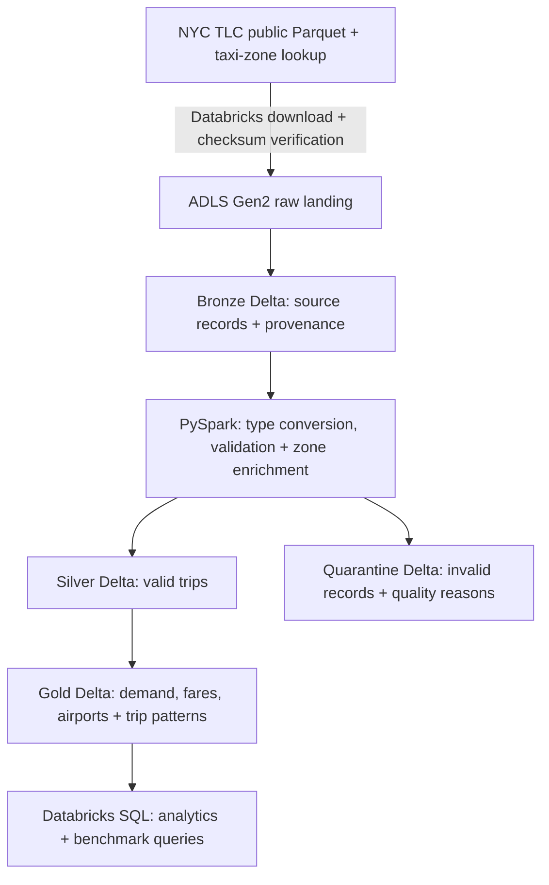

# NYC Taxi Lakehouse

An Azure Databricks data engineering project that turns public taxi records into
analytics-ready Delta tables and measures the cost, performance, and correctness
tradeoffs behind its design.

**Stack:** Azure Databricks, ADLS Gen2, PySpark, Delta Lake, Unity Catalog,
Databricks SQL, Terraform, Python, pytest.

**Scale:** A **41.2M-row annual Silver dataset** for layout experiments and
**9.55M input records per Q1 pipeline replay** for compute experiments.

## Measured results and engineering decisions

| Experiment | Measured outcome | Decision and evidence |
|---|---|---|
| Standard serverless vs. classic Jobs | **65.6% lower aggregate compute/infrastructure cost** and **43.2% lower median end-to-end runtime** on serverless: **9.0 vs. 15.9 minutes** | Retained Standard serverless. [Compute results](benchmarks/compute_q1_2024.json) |
| 2X-Small vs. X-Small SQL warehouses | **33% lower median whole-session compute estimate** at comparable throughput, approximately **140 queries/minute**, across **8,504 measured queries** | Retained 2X-Small for this workload. [SQL sizing results](benchmarks/sql_warehouse_clean_q1_2024.json) |
| Partitioning vs. liquid clustering | **45.2% fewer bytes read** for a selective demand query on **41.2M rows**, without a material client-latency improvement | Retained production month partitioning. [Layout results](benchmarks/layout_annual_2024_queries.json) |
| Full vs. incremental Gold updates | Incremental updates wrote **63.4% fewer data-file bytes**, but the Gold operation was **2.89x slower** for the tested March append | Retained full Gold rebuilds at this scale. [Gold results](benchmarks/gold_incremental_q1_2024.json) |

These are controlled project observations, **not claims of newly realized
production savings**. Compute used three replays per configuration, with different
runtime/hardware configurations and uncontrolled physical caches. Combined costs
include classic Azure VMs, disks, public IPs, and bandwidth; they are provisional,
exclude shared storage and experiment/audit overhead, and are not total project
spending. Cost reduction compares three-replay totals, while runtime reduction
compares medians.

[Full experiment log, methodology, limitations, and evidence](benchmarks/README.md)

## Pipeline architecture



**Databricks performs the processing; ADLS Gen2 persists the files.** Raw data,
Delta tables, and benchmark artifacts live in Azure storage. Unity Catalog
governs table and volume access, with managed-identity storage access through
Azure RBAC.

This is a **scheduled batch pipeline**, not a streaming or Auto Loader
implementation. Ingestion processes new source months incrementally; the retained
Gold strategy rebuilds the aggregate tables.

## What was implemented

- **Reliable ingestion:** Source discovery, SHA-256 verification, download
  manifests, upstream-revision detection, and bounded backfills of up to three
  new source months per run by default.
- **Replay-safe processing:** Completed-month tracking and month-scoped Delta
  replacement support no-op reruns and explicit reprocessing without blindly
  appending duplicate data.
- **Explicit data quality:** Safe type conversion, timestamp/duration checks,
  finite nonnegative distance validation, zone enrichment, and quarantine with
  row-level rejection reasons. Refunds and duplicate candidates are preserved
  rather than silently discarded.
- **Infrastructure and governance:** Terraform-managed Azure storage, a Databricks
  access connector, managed identity, Azure RBAC, and Unity Catalog integration.
  Databricks Asset Bundles define the pipeline and isolated experiment jobs.
- **Operational visibility:** Per-run and per-stage timings, source-file status,
  row-count reconciliation, SQL monitoring queries, and pytest/PySpark tests
  covering ingestion, transformations, and benchmark guardrails.

The frozen Q1 baseline reconciled **9,554,778 input rows** into **9,551,977 valid
Silver rows** and **2,801 quarantined rows**.

Gold tables support hourly pickup-zone demand, monthly fares and refunds,
airport activity, and trip-distance/duration patterns. Example queries are in
[`queries/analytics.sql`](queries/analytics.sql).

## How the measurements were made credible

<details>
<summary>Reproducibility, correctness, and cost attribution</summary>

- Frozen Delta versions, checksum-pinned inputs, source hashes, and isolated
  output schemas kept successful comparisons traceable without modifying
  production or the frozen baseline.
- Compute trials used three replays per configuration with interleaved run
  ordering. Timers separated total job duration, pipeline-call time, internal
  processing, and API-reported setup.
- Successful pipeline comparisons required exact Bronze/Silver/quarantine row
  multisets excluding provenance. Gold keys, counts, and decimal metrics matched;
  floating aggregates used documented absolute-plus-relative tolerances.
- SQL experiments disabled result caching and collected query profiles.
  Physical I/O caches were not forcibly cleared, so results are not cold-cache
  or concurrency benchmarks.
- Databricks DBUs were priced at effective USD list prices. Classic comparisons
  additionally reconciled Azure resource costs; VM resources shared across runs
  were counted once. Combined costs use aggregate totals or amortized means,
  not fabricated per-run infrastructure medians.
- Failed attempts and diagnostics were retained separately rather than pooled
  into successful results. Portable JSON evidence is committed under
  [`benchmarks/`](benchmarks/); raw data, full operational reports, credentials,
  and Terraform state are not committed.

</details>

## Repository guide

| Path | Purpose |
|---|---|
| [`src/nyc_taxi_lakehouse/`](src/nyc_taxi_lakehouse/) | Ingestion, transformations, Gold logic, and experiment controllers |
| [`infra/`](infra/) | Terraform for Azure storage and Databricks governance integration |
| [`databricks.yml`](databricks.yml), [`resources/`](resources/) | Main Asset Bundle and job definitions |
| [`experiments/`](experiments/), [`compute-experiments/`](compute-experiments/) | Isolated benchmark job bundles |
| [`benchmarks/`](benchmarks/) | Recorded results, methodology, decisions, and evidence hashes |
| [`queries/`](queries/) | Analytics and operational monitoring SQL |
| [`tests/`](tests/) | Local pytest/PySpark tests |

## Local development and project status

Use **Python 3.12** and **Java 17**, with `JAVA_HOME` pointing to the Java
installation for local Spark tests:

```bash
python3.12 -m venv .venv
source .venv/bin/activate
python -m pip install -e ".[dev,benchmark]"
pytest -q
ruff check .
ruff format --check .
```

Cloud deployment requires an existing Unity Catalog-enabled Azure Databricks
workspace, appropriate Azure/Databricks permissions, Terraform, and the
Databricks CLI. The infrastructure configuration template is
[`infra/terraform.tfvars.example`](infra/terraform.tfvars.example); real variable
files and state remain Git-ignored. Cloud runs incur charges.

**Current status:** Benchmark collection is complete and the recurring pipeline
is **paused**. The bundle defaults to `schedule_pause_status: PAUSED`, so
redeployment does not automatically resume the daily schedule. Data and evidence
are retained; Azure storage charges can continue while compute is stopped.

**Data source:** [NYC Taxi & Limousine Commission trip records](https://www.nyc.gov/site/tlc/about/tlc-trip-record-data.page).
